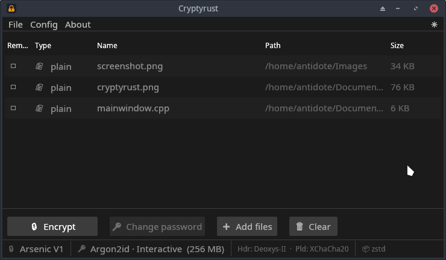

[](https://github.com/Antidote1911/cryptyrust/actions/workflows/ci.yml)
[](https://opensource.org/licenses/GPL-3.0)

# Cryptyrust

**Cross-platform file encryption — drag-and-drop GUI and command line.**

Cryptyrust protects files with a password, with the public keys of the people
who must be able to open them, or with both. Drop files on the window to
encrypt them; drop encrypted files to decrypt them. The same program is also a
command-line tool for scripts.

Encryption is post-quantum hybrid and the file format is fully documented.
The interface is available in English and French.



---

## Install

Download the build for your system from the
[releases page](https://github.com/Antidote1911/cryptyrust/releases/latest):

| System | File |
|---|---|
| Linux (any distribution) | `cryptyrust-<version>-linux.AppImage` |
| Debian, Ubuntu and derivatives | `cryptyrust_<version>_amd64.deb` — `sudo apt install ./cryptyrust_<version>_amd64.deb` |
| Arch Linux and derivatives (AUR) | [`cryptyrust-bin`](https://aur.archlinux.org/packages/cryptyrust-bin) — `yay -S cryptyrust-bin` — or [`cryptyrust`](https://aur.archlinux.org/packages/cryptyrust), built from the sources |
| Linux (Flatpak) | `cryptyrust-<version>-linux.flatpak` — `flatpak install cryptyrust-<version>-linux.flatpak` |
| macOS (Intel and Apple Silicon) | `cryptyrust-<version>-macos-universal.dmg` |
| Windows | `cryptyrust-<version>-win-setup.exe` (installer) or `…-win-portable.zip` |

The Debian package and the Flatpak bundle come with the releases after 3.1.0.
The Flatpak keeps its own keystore, separate from the one of a
Cryptyrust installed another way.

To build it yourself, see [`DEVELOPMENT.md`](DEVELOPMENT.md).

---

## Features

- **Arsenic V2** format (`.arsn`) — fully documented in [`arsenic/FORMAT.md`](arsenic/FORMAT.md)
- **Post-quantum hybrid encryption** — X25519 + ML-KEM-768 or ML-KEM-1024 (NIST FIPS 203)
- **Multiple passwords** — up to 16 equal passwords per file; any of them opens and manages it
- **ASCII armor** — base64 transport encoding for email / text channels; auto-detected on decrypt
- **Optional zstd compression** — compress before encrypting (levels 1–22); size-leak warning shown
- **Drag-and-drop GUI** — drop `.arsn` or `.arsn.armor` files to decrypt; plaintext to encrypt
- **CLI** for scripting and automation — same binary, same keystore
- **Integrated key management** — X25519 + ML-KEM keypairs, shared between GUI and CLI
- Three independently selectable **AEAD ciphers** for header and payload
- **Argon2id** key derivation (Interactive 256 MiB / Sensitive 1 GiB)
- **Password change** without re-encrypting the payload — O(1) regardless of file size
- **Recipient management** — add/remove asymmetric keyslots post-encryption
- **Built-in benchmark** — find the fastest cipher for your machine
- **English and French** interface, light and dark theme
- Cross-platform: Linux, Windows, macOS

---

## GUI — Quick Start

1. **Drag and drop** files onto the window, or click **Add files**.
2. Mode is auto-detected: `.arsn` / `.arsn.armor` → **Decrypt**, plaintext → **Encrypt**.
3. Click **Encrypt** / **Decrypt** and enter the password.

### Encrypting for recipients (asymmetric, passwordless)

1. Open **Keys → Key Manager** → click **⚡ Generate** to create a keypair.
2. Share your `.pubkey` file with correspondents.
3. When encrypting, select recipients in the popup — the password becomes optional.

### Settings

**Config → Settings…** opens the settings window. Choices are saved between
sessions.

| Page | Setting | Options | Default |
|---|---|---|---|
| General | Language | English · Français | System language |
| General | Theme | Light · Dark | System theme |
| Encryption | Argon2id strength | Interactive (256 MiB) · Sensitive (1 GiB) | Interactive |
| Encryption | Header cipher | Deoxys-II-256 · AES-256-GCM-SIV · XChaCha20-Poly1305 | Deoxys-II-256 |
| Encryption | Payload cipher | XChaCha20-Poly1305 · AES-256-GCM-SIV · Deoxys-II-256 | XChaCha20-Poly1305 |
| Encryption | ML-KEM level | ML-KEM-768 · ML-KEM-1024 | ML-KEM-768 |
| Output | Compression | Disabled · zstd level 1–22 | Disabled |
| Output | Format | Binary (`.arsn`) · ASCII armor (`.arsn.armor`) | Binary |

**Config → Benchmark ciphers…** finds the fastest cipher for your machine.

---

## CLI — Quick Usage

Run with arguments, `cryptyrust` is a command-line tool. The full reference is
in [`cryptyrust/README.md`](cryptyrust/README.md).

```bash
# Encrypt with password
cryptyrust -e document.pdf

# Encrypt for recipients
cryptyrust -e document.pdf -R alice -R bob

# Encrypt with ML-KEM-1024 (NIST Level 5)
cryptyrust -e document.pdf -R alice --kem-level 1024

# Encrypt with ASCII armor output (.arsn.armor)
cryptyrust -e document.pdf --armor

# Encrypt with zstd compression (level 3, default; or specify 1–22)
cryptyrust -e document.pdf --compress
cryptyrust -e document.pdf --compress 9

# Combine compression + armor
cryptyrust -e document.pdf --compress 6 --armor

# Decrypt (auto-detects armor, auto-tries stored keys)
cryptyrust -d document.pdf.arsn
cryptyrust -d document.pdf.arsn.armor

# Change password without re-encrypting
cryptyrust --rekey document.pdf.arsn

# Benchmark ciphers
cryptyrust --bench
```

---

## Key Management

```bash
# Generate a keypair (X25519 + ML-KEM-768)
cryptyrust keygen -n alice --store
cryptyrust keygen -n alice -o alice.key

# List stored keypairs
cryptyrust keygen --list

# Export public key
cryptyrust keygen -y alice.key
```

### Recipient management

```bash
cryptyrust recipients list file.pdf.arsn
cryptyrust recipients add file.pdf.arsn -R bob -p "passphrase"
cryptyrust recipients remove file.pdf.arsn -i alice.key -p "passphrase"
cryptyrust recipients remove file.pdf.arsn --slot 0 -p "passphrase"
```

### Passphrase slot management

```bash
# Count the passwords of a file
cryptyrust passphrase list file.pdf.arsn

# Add a password (any password of the file authenticates)
cryptyrust passphrase add file.pdf.arsn -p "a-current-password" --new-pass "second-password"

# Remove a password (any password of the file authenticates)
cryptyrust passphrase remove file.pdf.arsn -p "a-current-password" --remove-pass "second-password"
```

---

## Data Loss Warning

If you lose or forget your password, **your data cannot be recovered.** There is no backdoor.
Use a password manager or keep a secure backup of your passphrase.

Losing your `.key` file when you encrypted for recipients without a password is also unrecoverable.

---

## Documentation

| Document | For |
|---|---|
| [`cryptyrust/README.md`](cryptyrust/README.md) | Users — full GUI and CLI reference |
| [`DEVELOPMENT.md`](DEVELOPMENT.md) | Developers — project layout, build, tests, translations |
| [`arsenic/README.md`](arsenic/README.md) | Developers — API of the cryptographic library |
| [`arsenic/FORMAT.md`](arsenic/FORMAT.md) | Specification of the Arsenic V2 file format |
| [`ffi/README.md`](ffi/README.md) | Developers — C-compatible FFI layer |
